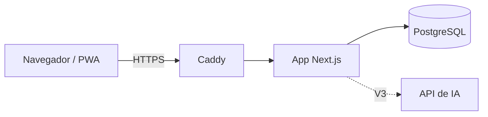

# StudyOS

> Planejamento, registro e notas de estudo em um só lugar, com gamificação para manter a constância.

O StudyOS registra **quanto** você estudou, **o quê** estudou e **como foi** o aproveitamento. Cada sessão
finalizada vira XP, alimenta o streak e enche a barra da meta semanal. Notas em Markdown, revisão espaçada e
IA (opcional) entram nas próximas fases.

> **Status:** fase de documentação e arquitetura. O código do MVP começa a partir desta base.

## Funcionalidades

**MVP**
- Cronômetro de estudo (livre ou Pomodoro) que sobrevive a recarregar a página
- Fechamento de sessão em segundos: aproveitamento de 1 a 5, tipo de estudo e resumo de uma linha
- XP ponderado pelo aproveitamento, níveis, streak diário e conquistas
- Tela de recompensa animada
- Dashboard com horas, heatmap de consistência e desempenho por matéria

**Próximas fases**
- Metas semanais, backlog de tópicos e notas em Markdown ligadas às sessões
- Revisão espaçada e flashcards
- IA para organizar notas, gerar flashcards e escrever um relatório semanal
- PWA instalável

## Stack

| Camada | Tecnologia |
|---|---|
| App (UI + API) | Next.js 15, React 19, TypeScript |
| Estilo | Tailwind CSS 4 |
| Dados | PostgreSQL 16 + Prisma 6 |
| Infra | Docker Compose, Caddy (HTTPS automático), VPS |
| IA (V3) | API do Claude, chamada só pelo backend |



## Começando (desenvolvimento)

Requisitos: Node.js 22+, Docker.

```bash
git clone <url-do-repo> studyos && cd studyos
cp .env.example .env
docker compose -f docker-compose.dev.yml up -d   # sobe só o Postgres
npm install
npx prisma migrate dev
npm run dev                                       # http://localhost:3000
```

## Deploy (VPS)

```bash
cp .env.example .env    # preencha DOMAIN, APP_PASSWORD, AUTH_SECRET, POSTGRES_PASSWORD
docker compose up -d --build
```

Detalhes, backup e restauração em [docs/07-deploy.md](docs/07-deploy.md).

## Estrutura

```
.
├── docs/               documentação do projeto (comece por docs/README.md)
│   └── adr/            decisões de arquitetura
├── prisma/             schema e migrações do banco
├── src/                código da aplicação (Next.js)
├── deploy/             Caddyfile e arquivos de operação
├── Dockerfile
├── docker-compose.yml       produção
└── docker-compose.dev.yml   banco para desenvolvimento
```

## Documentação

Toda a documentação está em [`docs/`](docs/README.md):
visão e requisitos, arquitetura, modelo de dados, contrato da API, regras de gamificação, integração com IA,
deploy, segurança, roadmap e convenções.

## Roadmap

Resumo em [docs/09-roadmap.md](docs/09-roadmap.md): **MVP** (sessões, gamificação, dashboard) → **V2**
(metas, notas, backlog) → **V3** (revisão espaçada, IA, PWA).

## Autor

Marcondes Simão do Nascimento Júnior · Análise e Desenvolvimento de Sistemas (UNIPÊ)
