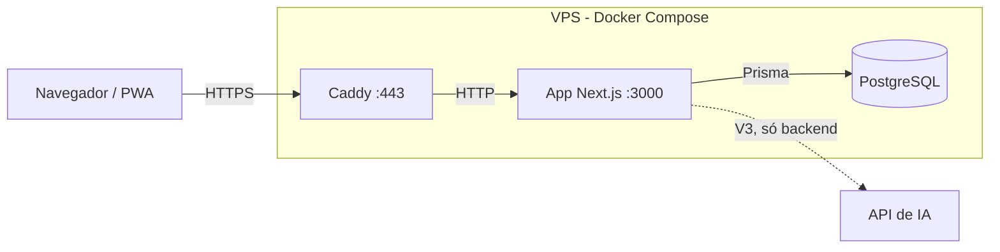
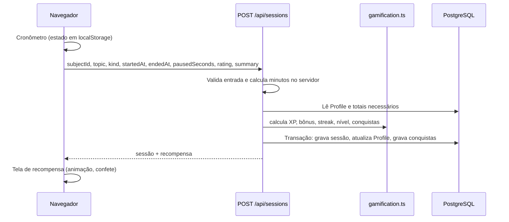

# 02 · Arquitetura

## Visão geral

Monólito web: **uma aplicação Next.js** (interface + API) falando com **PostgreSQL**, atrás de um **Caddy**
que cuida de HTTPS. Tudo roda em contêineres numa VPS via Docker Compose. A IA (a partir da V3) é chamada
apenas pelo backend.



## Componentes

| Componente | Responsabilidade | Tecnologia |
|---|---|---|
| Proxy | TLS automático, compressão, proxy reverso | Caddy 2 |
| App | Páginas (React), rotas de API, regras de negócio, auth | Next.js 15, TypeScript |
| Estilo | UI e animações | Tailwind CSS 4 |
| Acesso a dados | Schema, migrações, queries tipadas | Prisma 6 |
| Banco | Persistência | PostgreSQL 16 |
| IA (V3) | Resumos, flashcards, relatório | API do Claude, via backend |

## Organização do código (alvo)

```
src/
  app/                 páginas e rotas de API (App Router)
    api/               handlers HTTP finos: validam entrada e chamam a camada de domínio
    login/ ...
  components/          componentes de UI (timer, heatmap, modal de recompensa)
  lib/
    db.ts              cliente Prisma singleton
    auth.ts            assinatura/verificação do cookie
    time.ts            utilitários de data no fuso APP_TZ
    gamification.ts    funções PURAS: XP, nível, streak, conquistas
    stats.ts           agregações do dashboard
prisma/                schema e migrações
docs/                  esta documentação
deploy/                Caddyfile e scripts de operação
```

**Regra de ouro:** regras de negócio (XP, nível, streak, conquistas) ficam em `lib/gamification.ts` como
funções puras, sem acesso a banco, para serem testáveis. Os handlers de API só orquestram.

## Fluxo principal: finalizar uma sessão



A duração é **recalculada no servidor** a partir de `startedAt` e `endedAt`; o cliente nunca informa minutos.

## Decisões de arquitetura

As decisões e alternativas descartadas estão em [`docs/adr/`](adr/):

- [ADR-0001](adr/0001-monolito-nextjs.md) · Monólito Next.js em vez de front e back separados
- [ADR-0002](adr/0002-postgresql-prisma.md) · PostgreSQL com Prisma
- [ADR-0003](adr/0003-auth-senha-unica.md) · Autenticação por senha única
- [ADR-0004](adr/0004-estado-derivado.md) · Perfil como cache derivado das sessões
- [ADR-0005](adr/0005-docker-compose-vps.md) · Deploy com Docker Compose na VPS

## Estado do cronômetro

- Vive no cliente (`localStorage`, chave `studyos.activeSession`) com `startedAt`, `subjectId`, `topic`, `pausedMs`.
- O tempo exibido é sempre `agora - startedAt - pausedMs`, nunca um contador incremental, para não driftar com a aba em segundo plano.
- Limite do servidor: sessão com mais de 12 h é rejeitada (provável timer esquecido); o cliente avisa a partir de 4 h.

## Limitações conhecidas

- Cronômetro ativo não sincroniza entre dispositivos (previsto para depois, se necessário).
- Instância única; sem alta disponibilidade. Aceitável para uso pessoal, mitigado por backups.
