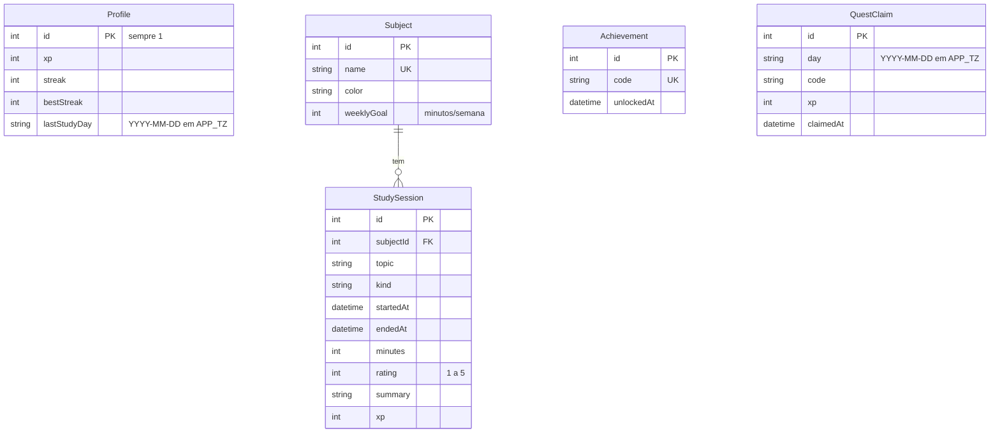

# 03 · Modelo de dados

Fonte da verdade: [`prisma/schema.prisma`](../prisma/schema.prisma). Este documento explica as decisões.

## Tabelas

### Profile
Linha única (`id = 1`). **Cache derivado**: pode ser reconstruído a partir de `StudySession` (ver
[ADR-0004](adr/0004-estado-derivado.md) e [05-gamificacao](05-gamificacao.md)).

### Subject
Matéria/área de estudo. `weeklyGoal` em minutos (0 = sem meta). Excluir uma matéria exclui suas sessões
(`onDelete: Cascade`); a interface deve pedir confirmação explícita e oferecer exportação antes.

### StudySession
- `minutes` é calculado no servidor: `round(((endedAt - startedAt) - pausedSeconds*1000) / 60000)`. As pausas chegam na requisição (`pausedSeconds`) e não são persistidas.
- `kind`: `estudo | leitura | pratica | revisao | projeto`.
- `rating`: inteiro de 1 a 5 (validado na API e por `CHECK` no banco, migração `0001_init`).
- `xp`: XP efetivamente concedido, incluindo bônus (guardado para o recálculo ser exato, já que há um bônus aleatório).
- Índices: `startedAt` (dashboard e heatmap) e `subjectId` (filtros).

### Achievement
`code` único; a conquista é desbloqueada uma vez. Catálogo de códigos em [05-gamificacao](05-gamificacao.md).

### QuestClaim (MVP)
Registro da coleta de uma missão do dia. `@@unique([day, code])` garante uma coleta por missão por dia.
O XP fica gravado na linha para o recálculo ser exato mesmo que as regras de missão mudem depois.

## Evolução prevista do schema

| Fase | Mudança |
|---|---|
| V2 | `Topic` (backlog: título, status, prioridade, matéria), `Note` (Markdown, ligada a sessão e/ou tópico, índice full-text) |
| V2 | `Profile`: campos de "congelar streak" (`freezeWeek`, `freezesUsed`) |
| V3 | `Review` (próxima data, intervalo, acertos), `Flashcard` (frente, verso, nota de origem) |
| V3 | `AiUsage` (data, tipo, tokens) para controle de custo |

Se virar multiusuário: criar `User`, adicionar `userId` em todas as tabelas e trocar `Profile.id = 1` por `Profile.userId`.

## Regras de integridade

- Datas são armazenadas em UTC (o Prisma grava `timestamp(3)` interpretado como UTC); o "dia" de estudo é sempre derivado no fuso `APP_TZ`.
- `endedAt > startedAt` e `minutes >= 1` (sessões menores que 1 min são descartadas na API). Ambas também são `CHECK` no banco (migração `0001_init`).
- Migrações são versionadas em `prisma/migrations` e aplicadas no start do contêiner (`prisma migrate deploy`).
