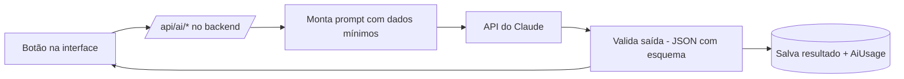

# 06 · Integração com IA (V3)

A IA entra **depois** que o núcleo (sessões, notas, revisão) estiver em uso. Ela é opcional: sem
`AI_API_KEY` configurada, os botões de IA ficam ocultos e nada mais muda.

## Casos de uso, por prioridade

| # | Recurso | Entrada | Saída | Gatilho |
|---|---|---|---|---|
| 1 | Organizar nota | Texto livre da nota | Nota em Markdown com tópicos, termos-chave e dúvidas em aberto | Botão na nota |
| 2 | Gerar flashcards | Uma nota | 3 a 10 pares pergunta/resposta (JSON) que viram `Flashcard` | Botão na nota |
| 3 | Relatório semanal | Agregados da semana (horas por matéria, notas médias, resumos) | Texto curto: o que funcionou, desequilíbrios, foco sugerido | Manual ou toda segunda |
| 4 | Planejador | Objetivo + data ("prova de Redes dia 10") + histórico | Sugestão de sessões por dia (o usuário aceita ou edita) | Manual |
| 5 | Tutor | Pergunta + notas relacionadas | Explicação baseada no que já foi anotado | Chat |

## Arquitetura

- A chave da API **só existe no servidor** (variável `AI_API_KEY`), nunca no navegador.
- Um módulo `src/lib/ai.ts` isola o provedor: trocar de modelo ou fornecedor não afeta o resto do código.
- Prompts ficam versionados em `src/lib/prompts/` como templates, não espalhados pelo código.
- Saídas estruturadas (flashcards, plano) são pedidas em JSON e **validadas com esquema** antes de salvar; se falhar, uma nova tentativa e depois erro amigável.

## Privacidade e dados

- Enviar só o necessário: a nota em questão, ou agregados para o relatório. Nunca o banco inteiro.
- Notas marcadas como privadas (campo futuro) nunca são enviadas.
- A IA gera **sugestões**; nada é salvo sem o usuário confirmar (exceto o relatório, que é só leitura).

## Custo e limites

- Tabela `AiUsage` registra tipo, tokens de entrada e saída e data.
- Limite diário configurável (`AI_DAILY_LIMIT`, número de chamadas). Ao atingir, a interface avisa.
- Timeout de 30 s por chamada; respostas longas usam streaming no relatório e no tutor.

## Segurança

- Conteúdo das notas é tratado como dado, não como instrução: o prompt delimita claramente o texto do usuário.
- A resposta da IA é renderizada como Markdown **sanitizado** (sem HTML bruto), como qualquer nota.
