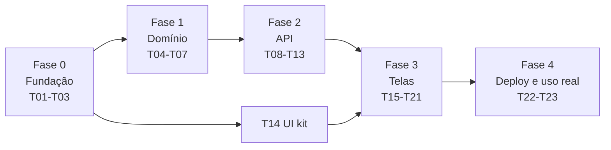

# 12 · Plano de execução (MVP com Claude Code)

Plano para construir o MVP em **tarefas pequenas, uma por sessão do Claude Code CLI**. Cada tarefa tem objetivo,
dependências, critério de pronto e um prompt pronto para colar.

## Como trabalhar com o Claude Code

O `CLAUDE.md` na raiz é lido automaticamente em toda sessão: ele dá o contexto, os comandos e as regras.
Não é preciso repetir isso nos prompts.

**Ciclo de cada tarefa**

```bash
git switch main && git pull
git switch -c feat/t05-gamificacao      # um branch por tarefa
claude                                   # abre o Claude Code na raiz do repo
```

1. Cole o prompt da tarefa.
2. Para tarefas maiores, use o **modo plano** (`Shift+Tab` até "plan mode"): revise o plano antes de deixar implementar.
3. Ao final, peça ou rode `npm run check` (lint + typecheck + testes). Nada é commitado com o check vermelho.
4. Revise o diff (`git diff`), faça o commit (Conventional Commits) e o merge na `main` (ou abra um PR para o CI rodar).
5. Marque a tarefa como feita no [roadmap](09-roadmap.md) e use `/clear` antes da próxima tarefa (contexto limpo = menos erro).

**Dicas**
- Referencie arquivos com `@`: `@docs/05-gamificacao.md`, `@docs/design/prototipo/Recompensa.dc.html`.
- Domínio (XP, streak, datas): peça **testes primeiro**, depois a implementação.
- Telas: sempre aponte o fonte do protótipo e peça para ficar idêntico.
- Se o Claude Code propuser mudar uma regra de negócio, a mudança vai para o doc no mesmo commit.
- Sessão travou ou desviou? `Esc` para interromper, `/clear` e recomece com o prompt da tarefa.

## Mapa das fases



| Fase | Tarefas | Resultado |
|---|---|---|
| 0 · Fundação | T01–T03 | Projeto roda, CI verde, design tokens e banco prontos |
| 1 · Domínio | T04–T07 | Regras de XP, nível, streak, conquistas e missões testadas |
| 2 · API | T08–T13 | Todas as rotas do MVP com validação e auth |
| 3 · Telas | T14–T21 | App navegável, idêntico ao protótipo |
| 4 · Produção | T22–T23 | No ar na VPS, com backup, em uso diário |

---

## Fase 0 · Fundação

### T01 · Base do projeto e ferramentas
**Depende de:** nada · **Pronto quando:** `npm run dev` abre uma página, `npm run check` passa e o CI roda no GitHub.

```text
Tarefa T01 do @docs/12-plano-de-execucao.md: deixar a base do projeto rodando.
- Verifique package.json, tsconfig, next.config e o Dockerfile existentes; ajuste o que for preciso para Next.js 15 + React 19.
- Crie src/app/layout.tsx e src/app/page.tsx mínimos (página "StudyOS" provisória).
- Adicione e configure: zod, vitest (+ @vitest/coverage-v8), ESLint (config do Next), Prettier.
- Scripts: dev, build, start, lint, typecheck (tsc --noEmit), test, test:watch, format, check (lint + typecheck + test).
- Crie .github/workflows/ci.yml: npm ci, check, build e docker build (sem push).
- Atualize o README se algum comando mudar.
Rode npm run check e npm run build no final.
```

### T02 · Design tokens, fontes e estilos globais
**Depende de:** T01 · **Pronto quando:** uma página `/dev/tokens` (só em desenvolvimento) mostra cores, fontes, sombras e as animações do protótipo.

```text
Tarefa T02 do @docs/12-plano-de-execucao.md. Leia @docs/11-design.md e os <helmet><style> de @docs/design/prototipo/.
- Configure Tailwind 4 com TODOS os tokens de cor, sombras duras e raio 0 como padrão (via @theme em globals.css).
- Carregue Unbounded, JetBrains Mono e Inter com next/font/google e exponha como font-display, font-mono, font-sans.
- Em globals.css: fundo com grade de pontos, keyframes (segpop, float, fall, flip, lvup, bump, pulse, claim, blink, flame, toast) e classes utilitárias equivalentes às do protótipo (.press, .lift, .seg.new...).
- Bloco @media (prefers-reduced-motion: reduce) desligando tudo.
- Página src/app/dev/tokens/page.tsx (retorna notFound() em produção) exibindo tudo isso.
```

### T03 · Banco: schema, migração e seed
**Depende de:** T01 · **Pronto quando:** `docker compose -f docker-compose.dev.yml up -d && npx prisma migrate dev` cria o banco e `npm run db:seed` popula dados de exemplo.

```text
Tarefa T03 do @docs/12-plano-de-execucao.md. Leia @docs/03-modelo-de-dados.md e @prisma/schema.prisma.
- Revise o schema conforme o doc (incluindo QuestClaim). Adicione CHECK de rating 1..5 via SQL na migração.
- Gere a migração inicial (prisma/migrations/0001_init).
- Crie src/lib/db.ts (PrismaClient singleton para dev com hot reload).
- Crie prisma/seed.ts com 4 matérias (Backend, Segurança, Infra, Faculdade, cores do @docs/11-design.md) e ~10 semanas de sessões realistas, para o dashboard ter o que mostrar. Script npm run db:seed.
- O seed NÃO deve ser executado em produção (proteja por NODE_ENV).
```

## Fase 1 · Domínio (funções puras, testes primeiro)

### T04 · Datas no fuso do app
**Depende de:** T01 · **Pronto quando:** `src/lib/time.ts` tem 100% de cobertura nos testes.

```text
Tarefa T04 do @docs/12-plano-de-execucao.md. Escreva PRIMEIRO os testes, depois a implementação de src/lib/time.ts.
Funções (todas recebem o fuso, padrão process.env.APP_TZ ?? 'America/Sao_Paulo'):
- dayKey(date, tz): "YYYY-MM-DD" do dia civil no fuso.
- previousDayKey(dayKey), startOfDay(dayKey, tz), startOfWeek(date, tz) (semana começa na segunda), hourInTz(date, tz).
- lastNDays(n, today) para o heatmap.
Use Intl.DateTimeFormat (sem bibliotecas de data, a menos que justifique).
Casos de teste obrigatórios: virada de meia-noite em UTC vs São Paulo, sessão que atravessa a meia-noite, segunda-feira como início de semana, ano bissexto.
```

### T05 · Gamificação: XP, nível, streak, conquistas
**Depende de:** T04 · **Pronto quando:** todas as regras de @docs/05-gamificacao.md têm teste e passam.

```text
Tarefa T05 do @docs/12-plano-de-execucao.md. Implemente src/lib/gamification.ts seguindo EXATAMENTE @docs/05-gamificacao.md. Testes primeiro.
- sessionXp({ minutes, rating, isFirstOfDay, random }) -> { base, multiplier, bonuses[], total }. O random é injetado (para testar o lucky_double).
- levelFromXp(xp), xpForLevel(level), progressInLevel(xp) -> { level, current, needed, fraction }.
- nextStreak({ lastStudyDay, streak, bestStreak }, sessionDay, sessionMinutes) com a regra dos 10 min.
- evaluateAchievements(context, alreadyUnlocked) -> códigos novos (catálogo completo do doc).
- Exporte o catálogo de conquistas com nome, descrição e ícone curto (ex.: '7D', '23H') para a UI.
Teste os exemplos numéricos do doc (ex.: 60 min, nota 4, primeira do dia = 92 XP) e as fronteiras de nível (99/100, 999/1000).
```

### T06 · Missões do dia
**Depende de:** T04 · **Pronto quando:** progresso e status das 3 missões testados.

```text
Tarefa T06 do @docs/12-plano-de-execucao.md. Implemente src/lib/quests.ts conforme a seção "Missões do dia" de @docs/05-gamificacao.md. Testes primeiro.
- QUESTS: catálogo das 3 missões (code, title, xp, target).
- questProgress(sessionsOfDay, claimsOfDay) -> lista com { code, title, xp, progress, target, status: in_progress|claimable|claimed }.
- canClaim(code, progress, claims).
Funções puras: recebem dados, não acessam banco.
```

### T07 · Recálculo do perfil
**Depende de:** T05, T06 · **Pronto quando:** recalcular a partir de sessões e coletas dá o mesmo resultado que o cálculo incremental.

```text
Tarefa T07 do @docs/12-plano-de-execucao.md. Leia @docs/adr/0004-estado-derivado.md.
- Em src/lib/gamification.ts: recomputeProfileFrom(sessions, claims, tz) -> { xp, streak, bestStreak, lastStudyDay } (pura).
- Em src/lib/profile.ts: recomputeProfile(prisma) que lê do banco, chama a função pura e grava em Profile.
- Teste de propriedade simples: para uma lista aleatória de sessões, aplicar incrementalmente (nextStreak + sessionXp) e recalcular do zero dão o mesmo resultado.
```

## Fase 2 · API

### T08 · Autenticação
**Depende de:** T01 · **Pronto quando:** sem cookie, qualquer página redireciona para `/login` e qualquer `/api/*` retorna 401 (menos login e health).

```text
Tarefa T08 do @docs/12-plano-de-execucao.md. Siga @docs/08-seguranca.md e @docs/adr/0003-auth-senha-unica.md.
- src/lib/auth.ts: comparar senha em tempo constante; criar e verificar o cookie HMAC-SHA256 (Web Crypto, para funcionar no middleware Edge).
- POST /api/login (com rate limit em memória: 5/min por IP), POST /api/logout.
- src/middleware.ts protegendo tudo exceto /login, /api/login, /api/health e assets.
- Checagem de Origin nas rotas que alteram dados (helper reutilizável).
- Página /login simples por enquanto (o visual final vem na T15).
- Testes para auth.ts e para o rate limit.
```

### T09 · Matérias
**Depende de:** T03, T08 · **Pronto quando:** CRUD completo com validação e testes de API.

```text
Tarefa T09 do @docs/12-plano-de-execucao.md. Implemente /api/subjects e /api/subjects/[id] conforme @docs/04-api.md.
- Validação com zod (schemas em src/lib/validation.ts), erros no formato { error: { code, message } }.
- DELETE remove as sessões em cascata e chama recomputeProfile.
- Testes de rota com um banco de teste (documente como subir no README) ou com um repositório em memória, o que ficar mais simples e confiável.
```

### T10 · Finalizar sessão (o endpoint mais importante)
**Depende de:** T05, T06, T07, T09 · **Pronto quando:** `POST /api/sessions` devolve o `reward` completo do doc, numa transação.

```text
Tarefa T10 do @docs/12-plano-de-execucao.md. Implemente POST /api/sessions exatamente como @docs/04-api.md.
- Valide a entrada (zod) e calcule os minutos no servidor (endedAt - startedAt - pausedSeconds).
- Numa transação Prisma: ler Profile, detectar primeira do dia, calcular XP (gamification.ts), atualizar streak, avaliar conquistas, gravar sessão, Profile e Achievements.
- Monte o reward com todos os campos *Before (xpBefore, levelBefore, streakBefore, subjectWeek.minutesBefore) e questsCompleted (missões que passaram a ficar coletáveis com esta sessão).
- Testes: sessão normal, primeira do dia, level up, streak que reinicia, sessão < 10 min (XP sim, streak não), entrada inválida, sessão > 12h.
```

### T11 · Listar, editar e excluir sessões
**Depende de:** T10 · **Pronto quando:** edição e exclusão recalculam o perfil.

```text
Tarefa T11 do @docs/12-plano-de-execucao.md. Implemente GET /api/sessions (paginação por cursor, filtros) e PATCH/DELETE /api/sessions/[id] conforme @docs/04-api.md.
- Ao mudar a nota, recalcule o XP base da sessão mantendo os bônus gravados; depois recomputeProfile.
- Testes para paginação, filtros e recálculo.
```

### T12 · Estatísticas do dashboard
**Depende de:** T10 · **Pronto quando:** `GET /api/stats` devolve o formato do doc em < 300 ms com o seed.

```text
Tarefa T12 do @docs/12-plano-de-execucao.md. Implemente GET /api/stats conforme @docs/04-api.md, com a lógica de agregação em src/lib/stats.ts (testável).
- Inclua tudo que o dashboard do protótipo mostra (@docs/design/prototipo/Main.dc.html): hoje, semana vs meta, XP de hoje, aproveitamento médio, melhor faixa de horário, heatmap de 12 semanas (minutos e nº de sessões por dia), metas por matéria, últimas 4 sessões e conquistas com progresso.
- Se o formato precisar de campos novos, atualize @docs/04-api.md no mesmo commit.
- Use SQL agregado ($queryRaw parametrizado) onde for mais eficiente.
```

### T13 · Missões e health
**Depende de:** T06, T10 · **Pronto quando:** coletar duas vezes devolve 409 e o XP entra uma única vez.

```text
Tarefa T13 do @docs/12-plano-de-execucao.md. Implemente GET /api/quests, POST /api/quests/[code]/claim e GET /api/health conforme @docs/04-api.md.
- A coleta usa a unicidade (day, code) do banco para evitar corrida; trate o erro como 409.
- Testes para os três status e para a coleta duplicada.
```

## Fase 3 · Telas (idênticas ao protótipo)

Regra para todas: abra o fonte do protótipo correspondente, mantenha os mesmos textos, espaçamentos, cores e
animações, e troque os dados de exemplo pelos da API.

### T14 · Kit de componentes
**Depende de:** T02 · **Pronto quando:** `/dev/tokens` também mostra todos os componentes em seus estados.

```text
Tarefa T14 do @docs/12-plano-de-execucao.md. Crie em src/components/ui os componentes da tabela "Componentes" de @docs/11-design.md que são genéricos: SegBar, HardButton, Toast (com provider), Confetti, StatValue (contador animado).
Crie também os hooks src/hooks/useReducedMotion.ts, useCountUp.ts e useSound.ts (Web Audio, preferência em localStorage, conforme a seção "Som").
Copie os estilos e keyframes de @docs/design/prototipo/. Adicione exemplos de cada um na página /dev/tokens.
```

### T15 · Login e layout do app
**Depende de:** T08, T14 · **Pronto quando:** login com o visual do app; cabeçalho com abas e nível (`LV.05` + `SegBar`) nas páginas internas.

```text
Tarefa T15 do @docs/12-plano-de-execucao.md. Usando o cabeçalho de @docs/design/prototipo/Main.dc.html:
- Layout autenticado (src/app/(app)/layout.tsx) com logo, abas (HOJE, SESSÕES, MATÉRIAS) e o bloco de nível lendo /api/stats.
- Página /login no estilo CommandBar (campo único "> senha"), erro animado e redirecionamento.
- Responsivo: abas quebram linha no celular.
```

### T16 · Matérias
**Depende de:** T09, T15

```text
Tarefa T16 do @docs/12-plano-de-execucao.md. Página /materias: listar, criar, editar (nome, cor, meta semanal em horas) e excluir com confirmação, seguindo os tokens de @docs/11-design.md. Mostre a meta da semana com SegBar de 12 blocos, como no dashboard do protótipo.
```

### T17 · Timer (sessão em andamento)
**Depende de:** T15, T16 · **Pronto quando:** recarregar a página não perde o tempo; idêntico a `Timer.dc.html`.

```text
Tarefa T17 do @docs/12-plano-de-execucao.md. Implemente /sessao igual a @docs/design/prototipo/Timer.dc.html.
- Estado da sessão ativa em localStorage (chave studyos.activeSession), conforme "Estado do cronômetro" em @docs/02-arquitetura.md. O tempo é sempre calculado por timestamps, nunca por contador.
- Início: escolher matéria e tópico (aceite ?materia=ID vindo do início rápido do dashboard).
- Modos Pomodoro 25/5 e Livre, grade de blocos, bloco atual piscando, "+1 XP" flutuante a cada minuto, overlay "BLOCO COMPLETO" com confete aos 25 min.
- Botão ×60 apenas quando NODE_ENV !== 'production'.
- Aviso a partir de 4h de sessão.
```

### T18 · Fim da sessão
**Depende de:** T10, T17

```text
Tarefa T18 do @docs/12-plano-de-execucao.md. Implemente /sessao/fim igual a @docs/design/prototipo/Avaliar.dc.html: barras de nota com animação, tipo, resumo de uma linha e prévia de XP que rola até o valor (mesma fórmula do servidor, importada de gamification.ts).
"SALVAR E COLETAR XP" envia POST /api/sessions, limpa a sessão ativa e leva para a recompensa com o reward retornado (guarde em sessionStorage para sobreviver a um refresh).
Trate erro de rede sem perder os dados digitados.
```

### T19 · Recompensa
**Depende de:** T18, T14 · **Pronto quando:** a sequência é idêntica ao protótipo e é dirigida pelo reward real.

```text
Tarefa T19 do @docs/12-plano-de-execucao.md. Implemente /sessao/recompensa igual a @docs/design/prototipo/Recompensa.dc.html.
- Hook src/hooks/useRewardSequence.ts com a linha do tempo da seção "Tela de recompensa" de @docs/05-gamificacao.md, alimentado pelo reward da API.
- Level up só quando reward.levelUp; streak gira só se streakIncreased; uma conquista por vez para newAchievements; missões que ficaram coletáveis viram um aviso "missão pronta para coletar".
- Som via useSound; tocar na tela pula para o estado final; prefers-reduced-motion mostra o estado final direto.
- Sem dados de reward (acesso direto à URL): redirecionar para /.
```

### T20 · Dashboard
**Depende de:** T12, T13, T15

```text
Tarefa T20 do @docs/12-plano-de-execucao.md. Implemente / igual a @docs/design/prototipo/Main.dc.html com dados de /api/stats e /api/quests:
CommandBar com início rápido por matéria, StreakCard, StatStrip com contadores, missões com COLETAR (+XP flutuante, toast, barra de nível animando), heatmap clicável com detalhe do dia, metas da semana, log de sessões e conquistas clicáveis com progresso.
Server Components para a carga inicial; componentes cliente só onde há interação. Estados vazios para quem ainda não tem sessões.
```

### T21 · Histórico de sessões
**Depende de:** T11, T15

```text
Tarefa T21 do @docs/12-plano-de-execucao.md. Página /sessoes com o estilo do SessionLog do protótipo: lista paginada, filtro por matéria e período, editar (nota, tipo, tópico, resumo, matéria) e excluir com confirmação. Após editar ou excluir, o nível e o streak no cabeçalho atualizam.
```

## Fase 4 · Produção

### T22 · Deploy na VPS
**Depende de:** T20 · **Pronto quando:** o app abre em HTTPS no seu domínio, o backup roda e a restauração foi testada.

```text
Tarefa T22 do @docs/12-plano-de-execucao.md. Prepare o deploy de @docs/07-deploy.md:
- Garanta que docker build e docker compose up funcionam do zero (migrações no start, usuário não-root).
- Adicione os cabeçalhos de segurança do @docs/08-seguranca.md (CSP incluída) no Caddyfile ou no next.config.
- Crie deploy/backup.sh e deploy/restore.sh com os comandos do doc, e um checklist de primeiro deploy em deploy/README.md.
- Não execute nada na VPS: apenas prepare os arquivos e me diga os comandos para eu rodar.
```

### T23 · Uso real e polimento
**Depende de:** T22 · **Pronto quando:** 7 dias seguidos de uso real.

Use o app todo dia. Anote atritos em issues do GitHub (rótulo `mvp-feedback`) e resolva com sessões curtas:

```text
Resolva a issue #N: <cole a descrição>. Mantenha o visual de @docs/11-design.md e atualize a documentação se a regra mudar.
```

---

## Depois do MVP

V2 (notas, backlog, congelar streak, exportação, missões variadas) e V3 (revisão espaçada, IA, PWA) seguem o
mesmo formato: antes de começar uma fase, peça ao Claude Code para **detalhar as tarefas daquela fase neste
documento**, revise e só então execute.
